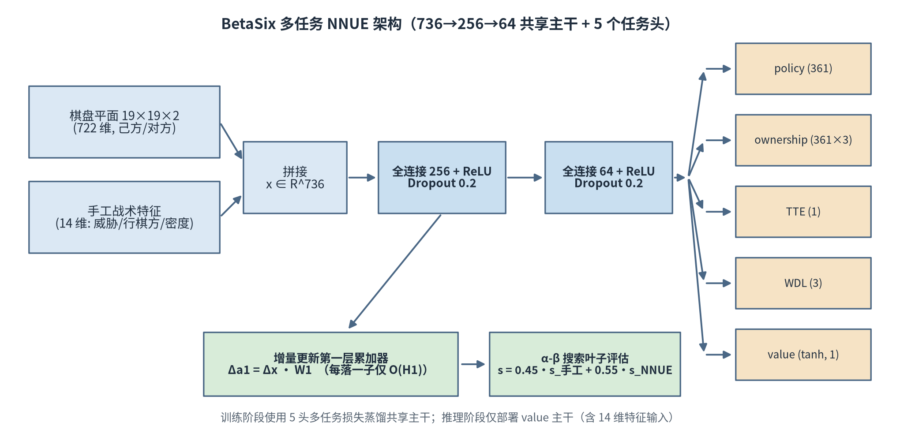

# BetaSix — 十九路六子棋 AI 引擎（简版技术报告）

**Copyright (c) 2026 白杨博贤**

据我们所知，这是首个将NNUE架构应用于六子棋的开源实现

## 1. 项目简介

BetaSix 是面向 19×19 六子棋（Connect6）的高效神经网络棋类引擎。六子棋规则为：黑先，黑方第一手落 1 子，此后双方每手各落 2 子（1-2-2-2），先在横、竖、斜任一方向连成六子者获胜；规则对称、无禁手。

引擎由三部分组成：

- **紧凑 NNUE 评估**：736→256→64→1 多层感知机，输入 722 维棋盘平面 + 14 维手工战术特征，参数约 20.5 万，单次前向约 0.2M 乘加；
- **多任务蒸馏训练**：KataGo 式五头（value / WDL / TTE / ownership / policy）联合训练共享主干，抑制单一标量的"捷径"过拟合，110 万自对弈样本；
- **增量更新 + α-β 搜索**：落子/撤子仅更新第一层累加器一列（O(H1) vs 全量 O(736·H1)），配合迭代加深、Zobrist 置换表、空着裁剪、LMR 与双子协同着法生成。

在自建 benchmark_v2（100 题五类战术基准）上，最终模型 weights_v7 取得 **90/100**。

## 2. 系统架构



- **输入**：722 维棋盘平面（19×19×2，己方/对方）+ 14 维手工战术特征（双方 open2/open3/sleep3/open4/double3 威胁计数、行棋方、落子密度、两个防守信号），共 736 维；
- **主干**：736→256→64（ReLU + Dropout 0.2），训练期挂 value/WDL/TTE/ownership/policy 五头，推理期仅部署 value 头；
- **增量更新**：第一层对棋盘平面线性，落子 = 加/减 one-hot 列，累加器 z 仅 O(H1) 更新，深度优先 α-β 搜索中评估吞吐提升约两个数量级；
- **评估融合**：s = 0.45·s_手工 + 0.55·s_NNUE，候选着法排序只用手工评分（防止网络噪声挤出关键防守点）；
- **着法生成**：棋子邻域候选 top-12 两两配对 + 协同奖励（邻接 +1200、共线 +900），适配每手双子规则。

## 3. benchmark 数据

评测协议：100 道局面题，标准答案由深度 10 搜索（1500ms）给出，待测模型以深度 5 搜索（400ms）作答，着法点对一致（允许两子顺序交换）即通过。

### 3.1 版本对比

| 模型 | 训练样本 | 总分 | 备注 |
| --- | --- | --- | --- |
| weights_v5 | 67 万 | 84/100 | 多任务五头版 |
| weights_v6 | 110 万 | 85/100 | 数据扩容 |
| weights_v7 | 110 万 + 编码修复 | **90/100** | 最终版 |
| 宽网 512/256/128 | 110 万 | 66/100 | 深层战术仅 4/20，放弃回滚 |

数据量翻倍仅 +1 分，而 f12/f13 特征编码修复 +5 分——训练与推理两侧的特征约定一致性才是瓶颈；单纯加宽网络（736→512→256→128）在 110 万样本下加剧过拟合，深层战术近乎崩盘。

### 3.2 weights_v7 分类得分（每类 20 题）

| 类别 | 得分 | 说明 |
| --- | --- | --- |
| 深层战术 | 14/20 | 3–5 手致胜序列 |
| 复杂中盘 | 19/20 | 双方均有威胁 |
| 诱导 | 18/20 | 表象与正解不符 |
| 终盘必杀 | 20/20 | 一步杀识别（满分） |
| 防守反击 | 19/20 | 先封堵后反击 |

辅助验证：同引擎双网络自对弈 10 局，v6 对 v5 取得 6 胜 4 负。

## 4. 七个致命缺陷摘要

训练—调试周期中发现并修复的七个根因级缺陷（详见 `connect6-nnue-v7/docs/BUGS_FOUND.md`）：

| # | 缺陷 | 根因 | 修复与效果 |
| --- | --- | --- | --- |
| 1 | 最优着法回退错误 | 迭代加深中 iterBest 无条件赋值 | 仅 alpha 提升时更新；抓杀 0%→60% |
| 2 | 评估非对称 | 两侧权重不等（+1188/−1188 等） | 对称化；空盘黑/白 ±622 |
| 3 | WDL 方向反转 | 标签为绝对胜方，未按行棋方归一 | 按行棋方翻转，loss 用 KL |
| 4 | 首手规则错误 | 每手均生成 2 子 | 首手 1 子；旧数据约 96 万条作废重生成 |
| 5 | 特征编码不一致 | f12/f13 数据用 OPP、引擎用 SELF | 引擎改用 OPP 视角；基准 85→90 |
| 6 | 成六判定颜色码错误 | 0/1 侧旗 vs 1/2 棋盘码混用 | has6(colour+1)；自对弈误判消除 |
| 7 | 宏与代码块错位 | NN_H2 宏定义错误、删块残留 | 显式定义 NN_H1/H2=256/64 |

核心教训：神经棋类系统中，数据管线、特征约定与搜索逻辑的"接口一致性"比网络结构本身更容易成为短板。

## 5. 目录说明

| 路径 | 内容 |
| --- | --- |
| `六子棋.py` | Tkinter 图形界面（19 路人机对战，子进程驱动引擎，带超时保护） |
| `六子棋NNUE引擎技术论文.docx` | 中文技术论文（11 页，公式/图表/参考文献） |
| `BetaSix_Connect6_Paper_EN.docx` | 英文技术论文（12 页） |
| `六子棋对局棋谱_game01.docx` | 77 手完整自对弈棋谱（含 153 子终局棋盘图） |
| `BetaSix简版技术报告.pdf` | 本报告的 PDF 版 |
| `paper_assets/` | 论文插图（中英文各 4 张） |
| `connect6-nnue-v7/` | 工程版：引擎源码 + 训练管线 + benchmark + 网页版（asm.js） |
| `connect6_engine/` | 发行版：引擎 + stdin/stdout 协议封装 + 构建脚本 |

（`connect6-nnue-v7/` 与 `connect6_engine/` 为源码工程目录。）

## 6. 构建与运行

**构建引擎**（Linux / Windows 双平台）：

```bash
cd connect6_engine
./build.sh
# 等价于: g++ -O2 -std=c++14 -msse4.1 -DNDEBUG -o connect6-engine-linux engine/engine_ab.cpp main.cpp
```

**引擎协议**（行式 stdin/stdout，每命令一行应答）：

| 命令 | 应答 | 说明 |
| --- | --- | --- |
| `START 19` | `OK` | 初始化 19 路 |
| `BOARD <361字符> <side>` | `OK` | 全量同步棋盘（'0'空 '1'黑 '2'白，side=行棋方） |
| `GO <时限ms> <深度>` | `= r1 c1 r2 c2` | 返回一手两子（0 基坐标；首手只返回 1 子） |
| `RESET` / `PING` / `QUIT` | `OK` / 退出 | 重开 / 心跳 / 退出 |

每次 GO 从 BOARD 载荷全量重建局面，悔棋/重开后引擎与界面状态天然一致。

**训练管线**：`gen_multitask.cpp`（限深自对弈生成 790 字节/样本）→ `merge_data.py`（合并）→ `train_multitask.py`（五头多任务训练，Adam 1e-3，batch 2048）→ 导出 `weights_v7.npz` / `nnue_A.h` 装入引擎。

**GUI**：`python3 六子棋.py`（需 Tkinter；自动探测 `connect6_engine/` 下的引擎可执行文件）。

## 7. 版权与引用

**Copyright (c) 2026 白杨博贤**

本仓库全部源码文件（.cpp / .h / .inc / .py / .sh）文件头均带此版权注释。如在研究或工程中使用本项目，请引用随附技术论文：

> 白杨博贤. BetaSix：面向十九路六子棋的多任务 NNUE 高效评估与 α-β 搜索. 2026.
